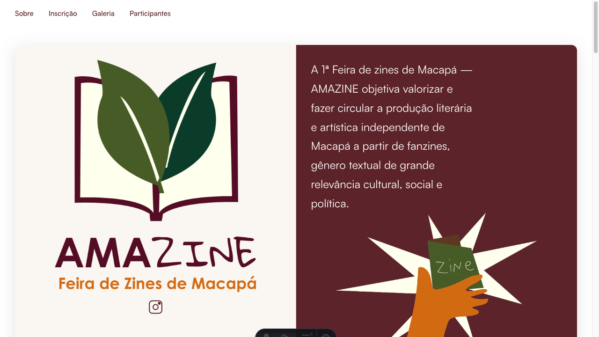
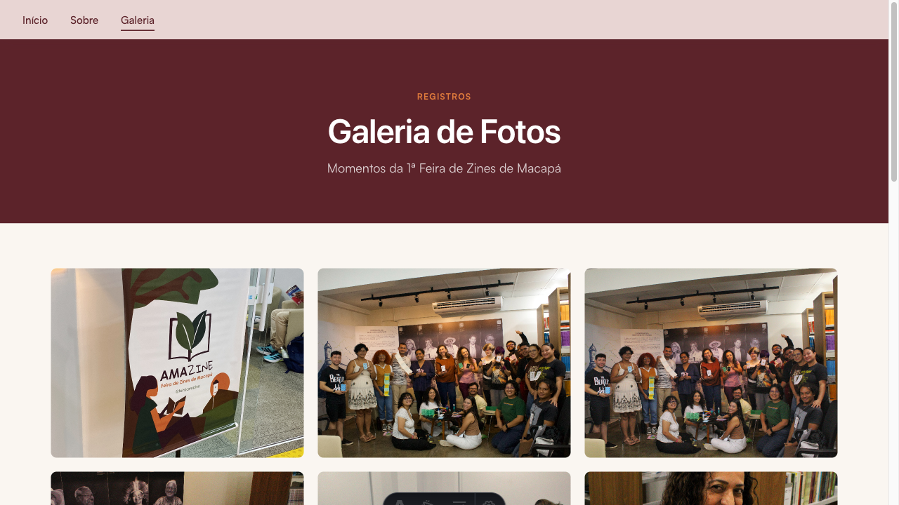

# AMAZINE



Site da primeira Feira de Zines de Macapá. A AMAZINE valoriza e faz circular a produção literária e artística independente de Macapá por meio de fanzines.

Construído com Astro e TypeScript, o site apresenta a programação da feira, explica o que são zines, reúne a primeira edição em um flipbook digital e disponibiliza uma galeria de fotos.


## Pré-requisitos

- Node.js compatível com Astro 5
- pnpm 10.27.0 ou superior

## Instalação

```bash
pnpm install
pnpm dev
```

O servidor de desenvolvimento fica disponível em [http://localhost:4321](http://localhost:4321).

## Scripts

| Comando | Descrição |
| --- | --- |
| `pnpm install` | Instala as dependências |
| `pnpm dev` | Inicia o servidor de desenvolvimento |
| `pnpm build` | Gera o site estático em `dist/` |
| `pnpm preview` | Pré-visualiza o build de produção |
| `pnpm astro ...` | Executa comandos do Astro |

## Rotas

- `/` apresenta a feira, a oficina de criação de zines, a primeira edição em flipbook e as pessoas responsáveis pela organização.
- `/galeria` exibe as fotos da feira em uma grade paginada, com visualizador em tela cheia e navegação por teclado.



## Galeria de fotos

As imagens da galeria são lidas durante o build a partir de um bucket Cloudflare R2 compatível com S3. Sem as credenciais, o site continua funcionando e exibe o estado vazio da galeria.

Crie um arquivo `.env` a partir do exemplo:

```bash
cp .env.example .env
```

Preencha as variáveis com as credenciais do bucket:

```dotenv
R2_ACCOUNT_ID=
R2_ACCESS_KEY_ID=
R2_SECRET_ACCESS_KEY=
R2_BUCKET_NAME=
```

As fotos devem estar no prefixo `amazine/gallery/`. O site aceita arquivos `.jpg`, `.jpeg`, `.png`, `.webp` e `.gif`.

## Estrutura

```text
.
├── public/              # Arquivos públicos, como favicon e imagem Open Graph
├── src/
│   ├── assets/          # Imagens, PDF e outros assets importados pelo Astro
│   ├── components/      # Componentes Astro reutilizáveis
│   ├── data/            # Integração e dados da galeria
│   ├── layouts/         # Layout base e metadados do site
│   └── pages/           # Rotas `/` e `/galeria`
├── astro.config.mjs    # Configuração do Astro
├── package.json         # Scripts e dependências
└── tsconfig.json        # Configuração estrita do TypeScript
```

## Contato

- E-mail: [feiraamazine@gmail.com](mailto:feiraamazine@gmail.com)
- Instagram: [@feiraamazine](https://instagram.com/feiraamazine)

## Créditos

AMAZINE é organizada por [Luana Góes](https://www.instagram.com/luana.g.m/), [Jeniffer Yara](https://www.instagram.com/jenifferyara_/) e [Coletivo Ventos do Norte](https://www.instagram.com/coletivoventosdonorte/).
